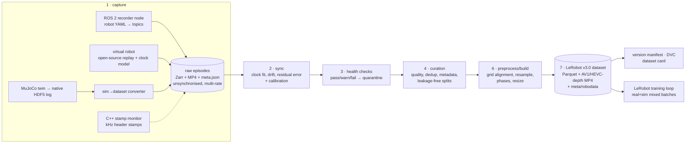

# robodata: multimodal robot-learning dataset pipeline (real + sim)

An end-to-end pipeline that **records → synchronises → validates → curates → packages** multimodal
robot demonstrations into versioned, LeRobot-format datasets that imitation-learning and foundation-model
training loops load directly. It runs on different robots from one YAML file each, and merges real and
simulated episodes into one schema.

## Status

- Built with AI-assisted development (Claude Code).
- The full validation on 17 public datasets (`docs/REPORT.md`) was run earlier on a larger machine.
- Re-run on an Apple M1 MacBook Air (8 GB) for one dataset, `pusht`: 22/22 tests passed,
  `robodata audit pusht` PASS, `robodata verify pusht` ok, 10/10 planted faults and 19/19 planted
  duplicates caught, 0 false positives on 94 genuine episodes.

### Quick start for a laptop

The `pusht` run above, with Docker Desktop given 5.5 GB of memory. Times are from that run.

```bash
docker compose build                                                        # 7 min 44 s
docker compose run --rm pipeline pytest                                     # 21 s
docker compose run --rm pipeline robodata fetch --source pusht              # 8 s
docker compose run --rm pipeline robodata ingest pusht --workers 2          # 22 s
docker compose run --rm pipeline robodata dupes --robot pusht --n 3         # 7 s
docker compose run --rm pipeline robodata faults --robot pusht --episodes 1 # 3 s
docker compose run --rm pipeline robodata health --robot pusht --workers 2 --quarantine  # 19 s
docker compose run --rm pipeline robodata curate pusht --workers 2          # 23 s
docker compose run --rm pipeline robodata build pusht --shards 2            # 68 s
docker compose run --rm pipeline robodata audit pusht                       # 13 s
docker compose run --rm pipeline robodata dedup-eval pusht                  # 1 s
docker compose run --rm pipeline robodata card pusht                        # 2 s
docker compose run --rm pipeline robodata version pusht                     # 1 s (needed before verify)
docker compose run --rm pipeline robodata verify pusht                      # 1 s
```

## Data used and where it comes from

All data is public, from the Hugging Face hub, plus one simulation generated by this repo. Each source is pinned to
an exact commit in `configs/sources/<name>.yaml`, and `robodata fetch` downloads exactly that commit and
episode subset (byte-identical; no manual download needed). Licences are as declared on each dataset page;
derived data inherits its source's licence.

| Config name | Source | Pinned revision | Robot | Episodes | Rate | Sensors | Licence |
|---|---|---|---|---|---|---|---|
| `catheter` | [giakhuyendihoc/catheter_force_depth_eef](https://huggingface.co/datasets/giakhuyendihoc/catheter_force_depth_eef) | `a30b07068fa3` | UR5 (real) | 100 | 30 Hz | 3 RGB (incl. wrist), 3 depth, joints, EE pose, 6-axis F/T, SpaceMouse target | Apache-2.0 |
| `sim_ur5` | generated by `robodata sim generate` ([MuJoCo](https://mujoco.org/); arm offsets from [MuJoCo Menagerie UR5e](https://github.com/google-deepmind/mujoco_menagerie/tree/main/universal_robots_ur5e)) | — | UR5 twin (sim) | 60 | 30 Hz cams, 500 Hz F/T | 3 RGB-D, joints, EE pose, F/T, teleop target, ground-truth phases | Apache-2.0 |
| `droid100` | [lerobot/droid_100](https://huggingface.co/datasets/lerobot/droid_100) | `87301a2d2e99` | Franka (DROID, real) | 100 | 15 Hz | 3 RGB, Cartesian state, velocity actions | MIT |
| `aloha_static_cups_open` | [lerobot/aloha_static_cups_open](https://huggingface.co/datasets/lerobot/aloha_static_cups_open) | `d793c969cf71` | ALOHA bimanual (real) | 40 | 50 Hz | 4 RGB (2 wrist), joints, actions | MIT |
| `aloha_sim_insertion_human` | [lerobot/aloha_sim_insertion_human](https://huggingface.co/datasets/lerobot/aloha_sim_insertion_human) | `cc571a3c661d` | ALOHA (sim) | 40 | 50 Hz | 1 RGB, joints, actions | MIT |
| `aloha_sim_transfer_cube_human` | [lerobot/aloha_sim_transfer_cube_human](https://huggingface.co/datasets/lerobot/aloha_sim_transfer_cube_human) | `6a43d500f101` | ALOHA (sim) | 40 | 50 Hz | 1 RGB, joints, actions | MIT |
| `pusht` | [lerobot/pusht](https://huggingface.co/datasets/lerobot/pusht) | `7628202a2180` | 2-D pusher (sim) | 100 | 10 Hz | 1 RGB (96 px), 2-D state, actions | MIT |
| `xarm_lift_medium` | [lerobot/xarm_lift_medium](https://huggingface.co/datasets/lerobot/xarm_lift_medium) | `79efb0e3cef0` | xArm (sim) | 100 | 15 Hz | 1 RGB (84 px), state, actions | MIT |
| `utokyo_xarm_pick_and_place` | [lerobot/utokyo_xarm_pick_and_place](https://huggingface.co/datasets/lerobot/utokyo_xarm_pick_and_place) | `da56c23e1b6d` | xArm (real) | 40 | 10 Hz | 3 RGB (incl. hand), state, actions | Apache-2.0 |
| `austin_buds_dataset` | [lerobot/austin_buds_dataset](https://huggingface.co/datasets/lerobot/austin_buds_dataset) | `d9f9289c349f` | Franka (real) | 40 | 5 Hz | 2 RGB (incl. wrist), 24-D state, actions | MIT |
| `svla_so101_pickplace` | [lerobot/svla_so101_pickplace](https://huggingface.co/datasets/lerobot/svla_so101_pickplace) | `f641879e2217` | SO-101 (real) | 40 | 30 Hz | 2 RGB, joints, actions | Apache-2.0 |
| `columbia_cairlab_pusht_real` | [lerobot/columbia_cairlab_pusht_real](https://huggingface.co/datasets/lerobot/columbia_cairlab_pusht_real) | `66482aa15878` | UR5 (real) | 40 | 10 Hz | 2 RGB (incl. wrist), state, actions | MIT |
| `libero_10_image` | [lerobot/libero_10_image](https://huggingface.co/datasets/lerobot/libero_10_image) | `7e324b526699` | Franka (sim) | 40 | 10 Hz | 2 RGB (incl. wrist, stored in parquet), state, actions | Apache-2.0 |
| `jaco_play` | [lerobot/jaco_play](https://huggingface.co/datasets/lerobot/jaco_play) | `265773f4d246` | Jaco (real) | 40 | 10 Hz | 2 RGB (incl. wrist), state, actions | CC-BY-4.0 |
| `iamlab_cmu_pickup_insert` | [lerobot/iamlab_cmu_pickup_insert](https://huggingface.co/datasets/lerobot/iamlab_cmu_pickup_insert) | `5806e1046ce1` | Franka (real) | 40 | 20 Hz | 2 RGB at two resolutions, state, actions | Apache-2.0 |
| `fmb` | [lerobot/fmb](https://huggingface.co/datasets/lerobot/fmb) | `76c86f111d32` | Franka (real) | 40 | 10 Hz | 4 RGB (2 wrist), state, actions | Apache-2.0 |
| `orange_cube_pnp_with_force` | [wengmister/orange_cube_pnp_with_force](https://huggingface.co/datasets/wengmister/orange_cube_pnp_with_force) | `83b8fe774717` | Franka + dexterous hand (real) | 40 | 30 Hz | 3 RGB (incl. wrist), 54-D state, actions | Apache-2.0 |
| `unitreeh1_fold_clothes` | [lerobot/unitreeh1_fold_clothes](https://huggingface.co/datasets/lerobot/unitreeh1_fold_clothes) | `a0926b4dd672` | Unitree H1 humanoid (real) | 12 | 50 Hz | 2 RGB (720p), state, actions | Apache-2.0 |

The first three are the main pipeline (`scripts/run_all.sh`); the other 15 are the scale-out validation
(`scripts/run_hub.sh`, listed in `configs/hub_datasets.txt`). "Episodes" is how many were used: the first N
of each dataset, downloaded partially. Only the UR5 sources include depth and force-torque, because the
LeRobot ports of the others dropped those streams. To add another hub dataset:
`robodata onboard <repo_id> --max-episodes N`.



## What each requirement maps to

| requirement | where | notes |
|---|---|---|
| **1 Multimodal capture (ROS 2 + Python)** | `ros2_ws/src/robodata_ros` (`recorder`, `replay`, `trigger` nodes), `src/robodata/recorder`, `configs/robots/*.yaml` | Each robot YAML lists streams (topic, msg type, rate, shape, required). The node stores the sensor stamp and the receive stamp for every message. Start/stop/discard services, `/diagnostics`. |
| ↳ C++ fast path (stretch) | `ros2_ws/src/robodata_capture_cpp/src/stamp_monitor.cpp` | `GenericSubscription` on *any* stamped type. Reads the header stamp straight from CDR bytes (no deserialisation), logs kHz streams, publishes live rate, latency and clock-step diagnostics. |
| **2 Sync & calibration** | `src/robodata/sync`, `src/robodata/calib` | Lower-envelope clock fit (TICSync-style) per stream for offset and drift, piecewise at clock jumps. Calibrated latency removal. Grid alignment. Residual sync error per episode, plus a data-driven camera-vs-motion lag check. Chessboard intrinsics, PnP extrinsics and eye-in-hand hand-eye, scored against simulator ground truth and stored as versioned calibration files. |
| **3 Health checks** | `src/robodata/health` | Dropped frames, burst gaps, rate, clock jumps, drift, corrupt/black/frozen frames, video↔timestamp mismatch, missing modalities, NaN/out-of-range, sync residual, idle and duration checks. Thresholds live in `configs/health/default.yaml`. Produces per-episode JSON plus MD/HTML/CSV reports and quarantines failures. A fault injector covers 11 fault types. |
| **4 Curation** | `src/robodata/curation` | Catalog with robot, task, operator, sensor-config hash, calibration version, success, source and is_sim. Quality score from health, success, idle time and smoothness (log dimensionless jerk). Near-dup detection requires *both* trajectory DTW and keyframe pHash to match. Deterministic group splits (session/scene) stratified by domain, with a leakage report. |
| **5 Synthetic data** | `src/robodata/sim` | MuJoCo UR5 twin. A scripted *human-like* teleoperator (min-jerk, tremor, reaction lag, misalignment, force-limited pushing) drives the arm, with natural failures. Sensors at native rates. The native HDF5 log goes through a config-driven converter into the real schema, with units and conventions converted, a sensor-noise model applied and `is_sim=True`. |
| **6 Preprocessing** | `src/robodata/preprocess` | Resampling to a common rate with per-modality interpolation (linear, slerp, hold, anti-aliased low-pass). Task-phase segmentation from kinematics and force, validated against sim ground truth. Resize. Inspection report with contact sheets, signals and a synced mosaic video. |
| **7 Schema, storage, versioning, release** | `src/robodata/io`, `src/robodata/storage`, `src/robodata/versioning`, `docs/STORAGE_AND_ENCODING.md` | Measured Parquet/Zarr/HDF5 and codec/CRF/GOP trade-offs. LeRobot v3.0 output via LeRobot's own writer. Content-hash versions with lineage (plus DVC). Generated dataset card. |

## Recreate everything from scratch

Everything needed is in this repository: code, all robot/source/dataset/health configs, the hub dataset
list (`configs/hub_datasets.txt`), the sim calibration, and every source pinned to an exact Hugging Face
commit. `data/` is generated and git-ignored.

**Prerequisites**

| Need | Detail |
|---|---|
| OS | Linux x86-64 (tested on Ubuntu 24.04) |
| Disk | ~30 GB for `data/` + ~6 GB for the Python environment (or ~5 GB for the Docker image) |
| CPU / RAM | 16 cores, 32 GB RAM used here; fewer cores just run slower (`--workers`, `--shards`) |
| GPU | Optional. Used only for MuJoCo rendering (`MUJOCO_GL=egl`) and training; `MUJOCO_GL=osmesa` works on CPU |
| Network | Access to huggingface.co (~6 GB of downloads). A `HF_TOKEN` is optional (higher rate limits) |
| Tools | Docker, **or** Python ≥ 3.10 with [uv](https://docs.astral.sh/uv/) |

**Option A: Docker (ROS 2 Jazzy + pipeline + LeRobot + MuJoCo)**

```bash
docker compose build                                           # ~5 GB image
docker compose run --rm pipeline pytest                        # 22 tests, synthetic data, no downloads
docker compose run --rm pipeline bash scripts/run_all.sh       # original pipeline: UR5 real + sim, DROID
docker compose run --rm pipeline bash scripts/run_hub.sh       # scale-out validation: 15 hub datasets
# ROS 2 end-to-end (after run_all.sh): replay a raw episode as live topics and record it again
EPISODE=/data/raw/ur5_sim/sim_scene_00/ur5_sim__sim_scene_00__ep000001 docker compose run --rm ros-demo
```

Data lands in `./data` on the host (mounted at `/data`).

**Option B: local Python**

```bash
uv venv --python 3.12 && source .venv/bin/activate && uv pip install -e ".[all]"
export MUJOCO_GL=egl            # or osmesa without a GPU
pytest                          # 22 tests
bash scripts/run_all.sh         # original pipeline: fetch -> ingest -> sim -> calibrate -> faults -> health -> curate -> build -> card/version -> inspect -> bench -> train
bash scripts/run_hub.sh         # 15 hub datasets: fetch -> ingest -> plant dupes/faults -> health -> curate -> build -> audit -> dedup-eval
```

Building the C++ / ROS 2 packages outside Docker needs a ROS 2 Jazzy install: `cd ros2_ws && python -m colcon build`.

**Run time measured here** (16 cores): `run_all.sh` about 1 hour (the 144-episode UR5 build with lossless
depth is the slowest step, about 8 min); `run_hub.sh` about 40 min, about 7 min of which is downloads.

**What you get, and how to check it matches**

| Output | Where | Check |
|---|---|---|
| 17 LeRobot v3.0 datasets (870 episodes, 228,072 frames) | `data/datasets/` | `robodata audit <name>` → PASS for each |
| Health reports + quarantined episodes | `data/reports/health/`, `data/quarantine/` | fault detection 73/73 |
| Dedup scores against planted duplicates | `data/reports/dedup_eval.csv` | `robodata dedup-eval` → 265/265, 0/596 false positives |
| Version manifests | `data/versions/` | `robodata verify <name>` |
| Full write-up | `docs/REPORT.md` | — |

**What is reproducible exactly, and what is not**

- **Downloads are byte-identical.** `robodata fetch` uses each source's pinned revision and episode list.
- **Raw episodes are reproducible.** Ingest clock noise, sim seeds and sensor noise are seeded deterministically.
- **Episode selection, splits and dedup decisions follow from those.** So do the scores in `docs/REPORT.md`.
- **Encoded video bytes may differ between machines or encoder versions.** Dataset version hashes therefore
  may too. The audit checks *content* (frames, values, alignment) against the original sources, which is the
  meaningful equality.
- **Reported numbers vs a fresh run.** The datasets in `docs/REPORT.md` were built while the code evolved.
  Real and hub data re-ingest exactly (verified). Simulated sensor noise used a per-process random seed until
  a late fix, so a fresh run's *sim* episodes get different noise. Expect small differences in sim-derived
  numbers (for example sync residuals), not different conclusions.

### Stage by stage

```bash
robodata fetch                                   # every source at its pinned revision + episode subset → data/sources
robodata ingest catheter                         # virtual robot replay → data/raw/ur5_catheter/...
robodata ingest droid100
robodata sim generate --episodes-per-scene 10    # MuJoCo → data/sim_logs/*.hdf5
robodata sim convert                             # sim log → data/raw/ur5_sim/... (is_sim=True)
robodata sim calibrate                           # intrinsics / extrinsics / hand-eye → configs/calibration/ur5_sim/v1.yaml
robodata faults --robot ur5_catheter             # (optional) inject faults to validate the health checks
robodata health --quarantine                     # sync + checks → data/reports/health/health_report.{md,html}
robodata curate ur5_insertion_mixed              # → data/curated/<name>/{catalog.parquet,splits.json}
robodata build ur5_insertion_mixed --shards 8    # → data/datasets/ur5_insertion_mixed (LeRobot v3.0)
robodata inspect ur5_insertion_mixed --video     # → data/reports/inspect/<name>/index.html
robodata card ur5_insertion_mixed && robodata version ur5_insertion_mixed && robodata verify ur5_insertion_mixed
robodata train-smoke ur5_insertion_mixed --steps 300 --sim-weight 0.3
robodata derive ur5_insertion_mixed --name ur5_insertion_mixed_rgb --drop-depth   # view for RGB-only policies
lerobot-train --dataset.repo_id=robodata/ur5_insertion_mixed_rgb --dataset.root=data/datasets/ur5_insertion_mixed_rgb \
  --policy.type=act --policy.push_to_hub=false --steps=1000                       # stock LeRobot, no conversion
robodata bench video && robodata bench formats
```

### Any LeRobot dataset from the Hub, plus validation

```bash
robodata onboard lerobot/pusht lerobot/aloha_static_cups_open --max-episodes 40   # pin, partial download, auto-configs
robodata ingest pusht && robodata dupes --robot pusht --n 3                       # plant ground-truth duplicates
robodata faults --robot pusht --episodes 1                                         # plant ground-truth faults
robodata health --robot pusht --quarantine && robodata curate pusht && robodata build pusht
robodata audit pusht        # independent cross-check: structure, leakage, fidelity vs. the original HF data
bash scripts/ingest_hub.sh && bash scripts/health_hub.sh && bash scripts/curate_hub.sh && bash scripts/build_audit_all.sh
```

See `docs/REPORT.md` for the full build and validation report (17 datasets, every bug found and how it was fixed).

### Recording on a real robot

```bash
ros2 launch robodata_ros record.launch.py robot:=ur5_catheter raw_root:=/data/raw task:="insert the cable" operator:=alice
ros2 service call /robodata_recorder/start std_srvs/srv/Trigger
ros2 param set /robodata_recorder success true && ros2 service call /robodata_recorder/stop std_srvs/srv/Trigger
ros2 launch robodata_capture_cpp stamp_monitor.launch.py     # optional: kHz stamp logging + live sync diagnostics
```

To add a robot, copy a file in `configs/robots/`, list its topics, rates and shapes, and map streams to
feature keys. Nothing else changes.

## Results on this data

See `docs/REPORT.md` for the final validation report; `RESULTS.md` holds the first-round numbers: sync accuracy vs ground truth,
health-check recall and false alarms, curation and splits, calibration errors, phase segmentation,
benchmarks and the training smoke test.

## Repository layout

```
configs/           robots/ (one YAML per rig) · sources/ (pinned open-source + sim mappings) · health/ · datasets/ (build recipes) · calibration/
src/robodata/      io/ recorder/ ingest/ sim/ sync/ calib/ health/ curation/ preprocess/ storage/ versioning/ train/ cli.py
ros2_ws/src/       robodata_ros (Python nodes + launch) · robodata_capture_cpp (C++ stamp monitor)
docker/            Dockerfile (ROS 2 Jazzy) · entrypoint
docs/              ARCHITECTURE.md · STORAGE_AND_ENCODING.md
scripts/           run_all.sh · build_all.sh
tests/             synthetic-robot tests for sync, health/fault injection, curation, splits, versioning
data/              (git-ignored, DVC-tracked) sources/ raw/ quarantine/ sim_logs/ curated/ datasets/ versions/ reports/
```

## Prior work this builds on

* **LeRobot** dataset format v3.0, depth quantisation and `aggregate_datasets`: the output is written
  with LeRobot's own writer, so it loads in any LeRobot training loop.
* **DROID** and **Open X-Embodiment**: multi-camera teleop rigs, per-episode metadata, success labels,
  wrist and exterior camera conventions.
* **rosetta**, **OpenTau `ros2lerobot`**, **ros2_unbag**: rosbag/ROS 2 to LeRobot conversion. These
  convert after the fact. robodata records unsynchronised raw data and keeps both clocks, so sync can be
  measured and redone.
* **TICSync** (Harrison & Newman, ICRA 2011): one-way-delay lower-envelope clock estimation. **Kalibr**
  and OpenCV hand-eye (Park & Martin): calibration practice.
* **embodied-sync**: residual-sync and dropped-frame reporting for multimodal robot data.
* **robomimic** and **ACT/ALOHA** (HDF5 episode logs, used for the native sim log) and the **Diffusion
  Policy** Zarr replay buffer (used for the raw layer).
* Flash and Hogan (min-jerk), Hogan and Sternad (dimensionless jerk) for the synthetic operator and
  smoothness score. Fod et al. (zero-velocity-crossing segmentation) for the phase heuristic.
