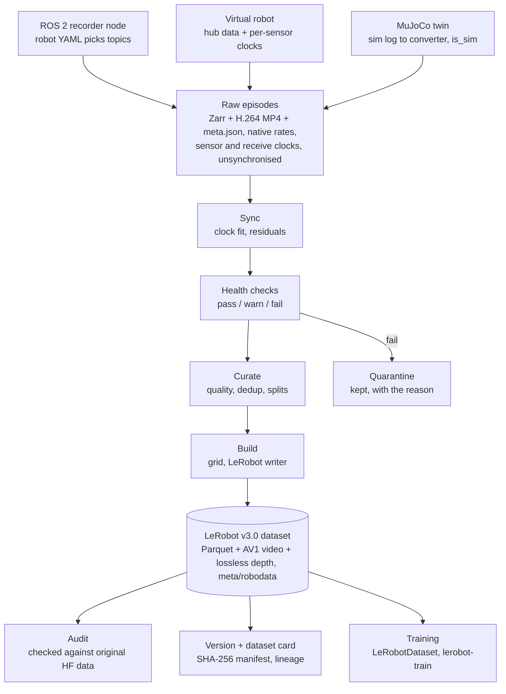

# robodata: Multimodal Robot-Learning Dataset Pipeline - Build & Validation Report

Oct 29, 2026 · Anikethan Venugopal · Live version: https://claude.ai/artifact/4ZVEVrAtBWPShTXqYCGTo1

## Summary

All 17 datasets built by the pipeline pass an independent audit against their original sources: 870 episodes and 228,072 training frames from 9 robot types. Planted ground truth was caught completely: 73/73 injected faults and 265/265 planted duplicates, with 0 false duplicates among 596 genuine episodes.

Scaling up and cross-verifying found and fixed real bugs that every earlier check had passed:

- actions shifted one frame late
- ~5% of depth frames silently dropped by a LeRobot encoder mode
- depth frames undecodable after some seeks
- five ROS 2 recorder defects
- health rules that did not transfer across frame rates and episode lengths
- a duplicate detector that missed trims and mislabelled uploads

The sections below explain each: what was done, why, and how.

| Dataset | Audit | Episodes | Frames | Rate |
| --- | --- | --- | --- | --- |
| ur5_insertion_mixed (real UR5 + MuJoCo twin) | PASS | 144 | 55,605 | 30 Hz |
| franka_droid100 | PASS | 98 | 31,942 | 15 Hz |
| pusht | PASS | 97 | 11,302 | 10 Hz |
| xarm_lift_medium | PASS | 97 | 2,311 | 15 Hz |
| aloha_static_cups_open | PASS | 37 | 14,732 | 50 Hz |
| austin_buds_dataset | PASS | 37 | 25,266 | 5 Hz |
| fmb | PASS | 37 | 6,892 | 10 Hz |
| iamlab_cmu_pickup_insert | PASS | 37 | 8,387 | 20 Hz |
| libero_10_image | PASS | 37 | 10,248 | 10 Hz |
| orange_cube_pnp_with_force | PASS | 35 | 7,152 | 30 Hz |
| svla_so101_pickplace | PASS | 35 | 7,844 | 30 Hz |
| aloha_sim_insertion_human | PASS | 34 | 16,952 | 50 Hz |
| aloha_sim_transfer_cube_human | PASS | 34 | 13,552 | 50 Hz |
| columbia_cairlab_pusht_real | PASS | 34 | 6,539 | 10 Hz |
| jaco_play | PASS | 34 | 2,449 | 10 Hz |
| utokyo_xarm_pick_and_place | PASS | 34 | 2,412 | 10 Hz |
| unitreeh1_fold_clothes | PASS | 9 | 4,487 | 50 Hz |

Each audit checks structure (every episode's first and last frame decodes in LeRobot; videos, stats and splits are consistent), leakage (no session or duplicate family spans splits), and fidelity (state, actions and frames match the original Hugging Face data at lag 0). Fewer episodes than were ingested means health quarantine, curation filters and dedup removed the rest; for example, 163 → 144 for UR5 mixed (16 failed sim demos, 3 planted duplicates).

## What was built

I built `robodata`, a Python package plus two ROS 2 packages (≈5,500 lines) and a Docker image (ROS 2 Jazzy). It takes multimodal robot demonstrations from recording to a versioned, training-ready LeRobot dataset, configured by one YAML file per robot.



All three capture paths write through the same recorder code into one raw format. Everything downstream is re-runnable without re-recording.

| Requirement | Where it lives |
| --- | --- |
| 1. Multimodal capture (ROS 2 + Python, optional C++) | `ros2_ws/src/robodata_ros` (recorder, replay, trigger nodes), `robodata_capture_cpp` (stamp monitor), `src/robodata/recorder` |
| 2. Synchronisation and calibration | `src/robodata/sync`, `src/robodata/calib` |
| 3. Health checks | `src/robodata/health` (checks, fault injector, reports, quarantine) |
| 4. Curation | `src/robodata/curation` (catalog, quality, dedup, leakage-free splits) |
| 5. Synthetic data | `src/robodata/sim` (MuJoCo twin, scripted operator, converter) |
| 6. Preprocessing | `src/robodata/preprocess` (alignment, phases, build, inspection) |
| 7. Schema, storage, versioning, release | `src/robodata/io`, `storage`, `versioning`; dataset cards |
| Cross-verification (added during testing) | `src/robodata/verify` (audit, dedup evaluation), `robodata onboard` / `dupes` |

## Data sources

The pipeline was exercised on 17 open-source datasets from the Hugging Face hub plus a MuJoCo simulation I built, about 1,050 recorded episodes covering 9 robot types. All of it was pinned to exact revisions in `data/sources/lock.json`.

| Dataset (Hugging Face) | Pinned revision | Robot | Episodes used | Rate | Cameras | Why it was chosen | Licence |
| --- | --- | --- | --- | --- | --- | --- | --- |
| [giakhuyendihoc/catheter_force_depth_eef](https://huggingface.co/datasets/giakhuyendihoc/catheter_force_depth_eef) | `a30b07068fa3` | UR5 (real) | 100 | 30 Hz | 3 RGB + 3 depth | Rare public set with wrist camera, depth, 6-axis F/T and teleop target together | Apache-2.0 |
| robodata.sim (generated here, no download) | — | UR5 twin ([MuJoCo](https://mujoco.org/), link offsets from [MuJoCo Menagerie UR5e](https://github.com/google-deepmind/mujoco_menagerie/tree/main/universal_robots_ur5e)) | 60 | 30 Hz cams, 500 Hz F/T | 3 RGB-D | Same schema as the real UR5, ground truth for clocks, phases and calibration | Apache-2.0 |
| [lerobot/droid_100](https://huggingface.co/datasets/lerobot/droid_100) | `87301a2d2e99` | Franka (DROID) | 100 | 15 Hz | 3 RGB | Different robot, Cartesian state, velocity actions | MIT |
| [lerobot/aloha_static_cups_open](https://huggingface.co/datasets/lerobot/aloha_static_cups_open) | `d793c969cf71` | ALOHA bimanual (real) | 40 | 50 Hz | 4 RGB | Highest-rate real data, two wrist cameras | MIT |
| [lerobot/aloha_sim_insertion_human](https://huggingface.co/datasets/lerobot/aloha_sim_insertion_human) | `cc571a3c661d` | ALOHA (sim) | 40 | 50 Hz | 1 RGB | Static sim scene: the hardest case for visual dedup | MIT |
| [lerobot/aloha_sim_transfer_cube_human](https://huggingface.co/datasets/lerobot/aloha_sim_transfer_cube_human) | `6a43d500f101` | ALOHA (sim) | 40 | 50 Hz | 1 RGB | Same robot, different task | MIT |
| [lerobot/pusht](https://huggingface.co/datasets/lerobot/pusht) | `7628202a2180` | 2-D pusher (sim) | 100 | 10 Hz | 1 RGB, 96 px | Tiny images, 2-D state | MIT |
| [lerobot/xarm_lift_medium](https://huggingface.co/datasets/lerobot/xarm_lift_medium) | `79efb0e3cef0` | xArm (sim) | 100 | 15 Hz | 1 RGB, 84 px | 1.7 s episodes stress duration rules | MIT |
| [lerobot/utokyo_xarm_pick_and_place](https://huggingface.co/datasets/lerobot/utokyo_xarm_pick_and_place) | `da56c23e1b6d` | xArm (real) | 40 | 10 Hz | 3 RGB | Three cameras incl. hand | Apache-2.0 |
| [lerobot/austin_buds_dataset](https://huggingface.co/datasets/lerobot/austin_buds_dataset) | `d9f9289c349f` | Franka (real) | 40 | 5 Hz | 2 RGB | Lowest rate, 24-D state, long episodes | MIT |
| [lerobot/svla_so101_pickplace](https://huggingface.co/datasets/lerobot/svla_so101_pickplace) | `f641879e2217` | SO-101 (real) | 40 | 30 Hz | 2 RGB | Popular low-cost arm | Apache-2.0 |
| [lerobot/columbia_cairlab_pusht_real](https://huggingface.co/datasets/lerobot/columbia_cairlab_pusht_real) | `66482aa15878` | UR5 (real) | 40 | 10 Hz | 2 RGB | Real counterpart of PushT | MIT |
| [lerobot/libero_10_image](https://huggingface.co/datasets/lerobot/libero_10_image) | `7e324b526699` | Franka (sim) | 40 | 10 Hz | 2 RGB | Images stored inside parquet, not video | Apache-2.0 |
| [lerobot/jaco_play](https://huggingface.co/datasets/lerobot/jaco_play) | `265773f4d246` | Jaco (real) | 40 | 10 Hz | 2 RGB | Different arm, per-episode language tasks | CC-BY-4.0 |
| [lerobot/iamlab_cmu_pickup_insert](https://huggingface.co/datasets/lerobot/iamlab_cmu_pickup_insert) | `5806e1046ce1` | Franka (real) | 40 | 20 Hz | 2 RGB, two resolutions | Cameras at different resolutions | Apache-2.0 |
| [lerobot/fmb](https://huggingface.co/datasets/lerobot/fmb) | `76c86f111d32` | Franka (real) | 40 | 10 Hz | 4 RGB | Four cameras, multi-task | Apache-2.0 |
| [wengmister/orange_cube_pnp_with_force](https://huggingface.co/datasets/wengmister/orange_cube_pnp_with_force) | `83b8fe774717` | Franka + dexterous hand | 40 | 30 Hz | 3 RGB | Community v2.1 format, 54-D state | Apache-2.0 |
| [lerobot/unitreeh1_fold_clothes](https://huggingface.co/datasets/lerobot/unitreeh1_fold_clothes) | `a0926b4dd672` | Unitree H1 humanoid | 12 | 50 Hz | 2 RGB, 720p | Largest frames, humanoid | Apache-2.0 |

Revisions are the first 12 characters of the Hugging Face commit, recorded in full in `data/sources/lock.json`. Fetching with them returns byte-identical files. For datasets marked 40 or 100 episodes, `robodata onboard` downloaded only the parquet and video files containing the first N episodes, not the whole dataset. Licences are as declared on each dataset page; derived data inherits its source's licence.

**Sensors covered.** The 18 robot setups record 90 streams: 70 from sensors and 20 commands.

| Stream type | Count | Setups |
| --- | --- | --- |
| RGB cameras (wrist, overhead, side, head) | 41 | All 18, 1–4 cameras each |
| Depth cameras | 6 | UR5 real (3), UR5 sim (3) |
| Joint encoders / proprioceptive state | 18 | All 18 |
| End-effector pose | 3 | UR5 real, UR5 sim, DROID |
| 6-axis force-torque | 2 | UR5 real (30 Hz), UR5 sim (500 Hz) |
| Commands: joint actions, teleop target poses, velocity | 20 | All 18 |

Only the UR5 setups carry every modality the brief names (RGB, depth, wrist camera, joints, force-torque, teleop), because the LeRobot ports of other datasets dropped depth and force-torque. Twelve setups are real-robot recordings; six are simulated (the MuJoCo twin, both ALOHA-sim datasets, PushT, xArm lift and LIBERO). No physical sensor was connected: every stream is recorded data, replayed through the recorder.

Two things made these datasets useful for testing rather than just for volume:

- **They are already clean.** Public LeRobot data is resampled to one clock. Every source episode was therefore replayed through the recorder by a *virtual robot* that re-applies realistic per-sensor clock offsets, drift, jitter, latency and drops. The original timing is kept as ground truth, so every sync and alignment result can be scored exactly.
- **Ground truth was planted on top.** I added 47 copies with injected faults (11 fault types) and 270 planted duplicates (6 duplicate types), each recording what was done to it. Every health and dedup number below is measured against that ground truth.

## Capture and synchronisation

The recorder stores every message twice-stamped and unsynchronised, and alignment happens offline. After correction, clock error is 0.24–1.55 ms at p95 against ground truth, on streams given up to 11 ms offset and 41 ms latency.

**Why record raw.** Every stream is stored at its native rate with the sensor's own timestamp (`header.stamp`) and the recorder's receive time. Resampling during recording would hide sync problems and make them impossible to fix later. Keeping both clocks means a better calibration or sync method can be re-run without re-recording, and sync quality becomes something measured, not assumed.

**How the clocks are fitted.** Transport delay is one-sided: a message can arrive late, never early. Least squares is therefore biased by the mean delay and its jitter. Instead, for each stream I fit the tightest line lying *under* all (sensor time, receive time) points, as a two-variable linear program; this is the TICSync idea. That gives offset and drift. The remaining constant (exposure and driver delay) isn't observable from timestamps, so the calibrated `known_latency_ms` from the robot config is subtracted. Clock steps are detected and fitted piecewise. In tests the envelope fit beats least squares by more than 4× in median error.

| Measure | Result |
| --- | --- |
| Clock error vs ground truth, p95 per episode (median / worst) | UR5 real 0.65 / 1.52 ms · sim 1.12 / 1.55 ms · DROID 0.24 / 1.19 ms |
| Residual camera-to-tick error in built datasets, p95 | 1.6–2.4 ms (stored per frame as `observation.sync_residual_ms`) |
| ROS 2 end-to-end (Docker, Jazzy): messages delivered | 10,083 / 10,085; 2 best-effort camera frames lost in DDS |
| ROS 2 recorded episode | passes health, residual p95 1.73 ms |
| C++ `stamp_monitor` | 4,647 / 4,647 force-torque messages at 499 Hz, reading the stamp from raw CDR bytes |

**A data finding.** In the original catheter recordings, wrist-camera motion lags end-effector motion by about 17 ms (half a frame), measured with the ground-truth clocks. The same estimator reads about 1 ms on sim, where the truth is 0. It is reported as a warning.

**Recorder bugs that only a real ROS 2 run exposed** (each found by the health checks on the ROS-recorded episode, then fixed):

1. **Late receive stamps.** Python `now()` in callbacks stamped 125/500 Hz messages up to ~770 ms late while image callbacks held the executor. Fix: use the middleware's `received_timestamp`, which then matched the C++ monitor (joint states 1.55 vs 1.84 ms p50).
2. **Queue overflow.** A 500 Hz force-torque stream lost 627 of 4,647 messages. Fix: queue depth set to about 4 s of messages per stream.
3. **Reordered frames.** A reentrant callback group let two callbacks of one image stream run at once, reordering depth frames. Fix: one mutually-exclusive callback group per stream.
4. **Slow callbacks.** Video encoding ran inside callbacks. Fix: an ordered worker thread per image stream.
5. **Python closure bug in the replay node.** It published one stream's images as another stream's messages. Fixed.

**Calibration** was scored against the simulator's exact camera parameters. Wrist hand-eye: 2.0 mm / 1.8°. Base camera extrinsics: 2.1 mm / 0.55°. Intrinsics within 1% for wrist and base. The front camera is weakest (4.9% focal error, 30 mm), because it is distant and only 20 board views were detected. Getting this right needed a fix for chessboard orientation ambiguity: all four corner orderings are tried, keeping the one whose board faces the camera and whose first square is black. Without it, hand-eye was off by 90° and extrinsics by 180°.

## Health checks

All 73 injected faults were caught (43 in the first round, 30 on the new hub data). Of 997 clean episodes, 11 were flagged, and every one was traced to a genuine problem.

Each episode gets a per-check JSON report with pass / warn / fail. Thresholds live in `configs/health/default.yaml` with per-robot overrides, and failing episodes are moved to `data/quarantine/` with the reason, never deleted. The checks: missing modality, dropped frames, burst gaps, rate deviation, non-monotonic stamps, clock jumps, clock drift, video↔timestamp mismatch, corrupt frames, frozen camera, NaN and out-of-range values, sync residual, duration, idle time, missing calibration.

**How the thresholds were set.** Every threshold was tuned against measured data, not guessed, and every false alarm was traced to its cause before changing a rule:

| False alarm | Cause found | Rule change | Evidence |
| --- | --- | --- | --- |
| Frozen camera on sim | Rendered images have no sensor noise | Camera noise model in the sim converter | Static real frames never repeat exactly (min diff 0.011) |
| Frozen camera after re-encode | Lossy codecs make frozen streams *almost* identical | Threshold 0.006 grey levels, bridges blips of up to 2 frames | Injected freezes caught; real static scenes untouched |
| Corrupt frames on DROID wrist (5 eps) | Sharp frames among motion-blurred ones | Spike must be isolated (2× both neighbours) | Real sharp runs last 17–140 frames; garbage is one frame |
| Corrupt frames on Austin BUDS (7 eps) | Grainy textureless view; keyframe vs predicted-frame grain | Absolute detail floor of 1,000 | False positives ≤ 196, real noise frames ≥ 2,640 (14× gap) |
| Gaps at 5 fps | One dropped frame = 400 ms > 250 ms limit | Gap limit = max(250 ms, 3.5 frame periods) | Austin BUDS false alarms 39 → 0 |
| Drop ratio in 25-frame episodes | One drop = 4% > 2% | Tolerate one isolated drop | xArm lift false alarms resolved |
| Clock drift on 1.7 s episodes | Drift is unmeasurable over 1.7 s (±2,400 ppm noise) | Judge drift only when its estimate noise < half the threshold | 20 xArm false alarms → 0; injected 3,000 ppm still caught on 4 s episodes |
| Motion lag (8 eps) | Cross-correlation heuristic is noisy | Warning only, never quarantines | — |

**What the 11 remaining flags are.** All genuine:

- **6 Jaco and uTokyo episodes** really lost 2 of 70–90 frames (about 2.5%) to the replay clock model's random drops.
- **2 DROID episodes:** one is 1.4 s long and idle; one lost more than 2% of camera frames.
- **1 Columbia episode** is genuinely too short.
- **2 Unitree H1 episodes** (the original and its re-upload). The *original Hugging Face video* has both head cameras frozen for 25 frames at the end of episode 2. That is a real source defect, confirmed by decoding the source file.

## Deduplication

The final detector catches all 265 planted duplicates that reached curation, across 6 types and 15 datasets, with 0 false positives on 596 genuine episodes. Getting there took six iterations, each driven by a measured miss.

**What was planted** (per dataset, from 3 source episodes):

- an exact copy in the same session
- an exact copy in **another** session, which would leak across train/val/eval if missed
- a re-encoded copy plus sensor noise
- an 8% trimmed copy
- an independent re-upload of the same source episode, with fresh clock noise and drops
- a **video swap**: one episode's footage attached to another episode's trajectory, i.e. a mislabelled upload

**How the final detector works.** Two episodes are copies when **both** their trajectories and their footage match:

- **Trajectory distance** is RMS per dimension after alignment, the smaller of two measures. One is open-ended DTW on sequences resampled at one rate per robot. The other is a shift-alignment distance that interpolates the original at the copy's own sample times.
- **Footage distance** is DTW over 32 z-normalised 16×12 thumbnails.
- **Exact copies** are caught by a byte hash.
- **A swapped video** must match on *every* frame: a 90th-percentile frame difference of at most 1.5 grey levels at 64×48.

Copies collapse to their best member. A recording whose footage appears under two different trajectories sends its whole family to human review, because the pipeline can't know which label is right.

| Iteration | Change and why | Trim | Re-upload | Video swap | False positives |
| --- | --- | --- | --- | --- | --- |
| 1. First version | pHash on 4 keyframes, grouped by task | 27 / 43 | 37 / 47 | 32 / 44 | 26 / 640 |
| 2. Search fixes | Pairs registered from either side (a real bug); group by robot not task (swaps crossed tasks); shift-tolerant prefilter | 33 / 43* | 47 / 47 | 44 / 44 | 36 / 596 |
| 3. Frame-level footage check | Static sim scenes made distinct demos look identical at 16×12; true swaps differ by exactly 0.0 grey levels, false alarms by ≥ 2.95 | 17 / 43 | 47 / 47 | 44 / 44 | **0** / 596 |
| 4. One sampling rate per robot, RMS per dimension | Trimmed copies were stretched by per-episode resampling; L2 over 54 dimensions inflated distances by √D | 37 / 43 | 47 / 47 | 44 / 44 | 0 / 596 |
| 5. Shift alignment | Interpolation-phase error on fast 50 Hz joints was as large as the threshold | **43 / 43** | **47 / 47** | **44 / 44** | **0** / 596 |
| 6. Duration and frame-count consistency | The audit of my own sim data found 2 unplanted false positives: the same path at 1.6× speed, and look-alike footage of different length | 43 / 43 | 47 / 47 | 44 / 44 | 0 / 596, plus 8 wrongly removed episodes restored |

\* Iteration 2's trim score was inflated. Copies were swept into "review" with their originals, which hid misses; switching the evaluator to cluster-level linking exposed the true 17/43.

Exact copies (same session, other session) and re-encoded copies were caught 44/44, 44/44 and 43/43 throughout. Families with more than one survivor fell from 7 to 0, so nothing can leak across splits.

**What ground truth alone missed.** Every planted copy keeps its original speed and length, so planted data could not expose that DTW is time-warp invariant. Two sim episodes whose random block positions landed 0.8 mm apart were flagged as copies, though one ran at 1.6× the speed of the other. A different speed profile is new training data. Two others (blocks 7.9 mm apart) were flagged as reused footage, though the videos had 192 vs 219 frames. Copies must now match in duration (within 25%, which still admits 8% trims), and reused footage in frame count (within 10%). This also restored 5 innocent "donor" episodes in the hub datasets, which had been linked to their own swap copies.

**Safety margin.** In every dataset, the farthest planted copy is closer than the nearest pair of *distinct* episodes. The tightest case is FMB (0.025 vs 0.074, 3×); PushT is 0.011 vs 0.077 (7×). Per-dataset numbers are in `data/reports/dedup_eval.csv`.

## Cross-verification audit

The audit compares each finished dataset back to the original Hugging Face data, and it found three bugs that every earlier check had passed. After the fixes, 88 audited episodes across 15 datasets have every action bit-exact and every camera frame aligned at lag 0.

`robodata audit <dataset>` deliberately re-derives everything from the output files instead of trusting pipeline metadata. Its three layers:

- **Structure.** Every episode's first and last frame is decoded through `LeRobotDataset` for every camera. Video packet counts must equal episode lengths. `stats.json` must equal stats recomputed from the parquet. Frame indices and timestamps must be contiguous, and the split ranges must cover each episode exactly once.
- **Leakage**, with its own fingerprint (resampled state plus a mid-episode thumbnail), independent of the dedup code. No recording session may span two splits, no near-identical content may sit across splits, and each planted duplicate family keeps at most one survivor.
- **Fidelity.** Sampled episodes are compared with the *original* source data at the ground-truth source frame: state, action and camera frames. Lags −2…+2 are scanned, so a systematic one-frame shift can't hide behind a small average error.

**Bugs it caught:**

| Bug | How it showed up | Root cause | Fix | After |
| --- | --- | --- | --- | --- |
| Actions one frame late | Built `action` and `teleop.target_pose` matched the source **exactly at lag −1**, error 0 | Zero-order hold picks the previous command when the corrected stamp lands ~1 ms after the tick | Hold with a quarter-period jitter tolerance (tolerance, not look-ahead) | 100% bit-exact at lag 0 in all 88 episodes |
| Depth frames undecodable after some seeks | One episode's last frame failed in LeRobot only after a specific access order; 2 of 1,176 random accesses failed (0.17%) | x265 defaults to open GOP with B-frames, so a seek can drop the leading pictures holding the target frame | Closed GOP, no B-frames for lossless 12-bit depth | 0 failures in 2,572 random-order accesses |
| ~5% of depth frames silently dropped | Contact sheet showed *sim* depth at the end of a *real* episode | LeRobot's streaming encoder drops frames when its queue fills (fine live, wrong offline) | Batch encoding, plus a packet-count gate on every build | Gate passes on all builds |

**Fidelity, 15 hub datasets:**

- Actions: 100% bit-exact at lag 0.
- Camera frames: 34.1–37 dB PSNR (median 37 dB) after two lossy encodes; best alignment at lag 0 in every case.
- State: median error 4e-5. The largest are in datasets with large units: PushT in pixels (up to 0.07 px), SO-101 in degrees (0.01°), and the 54-D orange-cube hand state. That is the expected linear-interpolation residual, velocity × ~1 ms of remaining clock error.
- Structure: 1,246 first and last frames decoded across 623 episodes and 32 video files. Stats match to within 4e-6 standard deviations.

## Storage, encoding and versioning

The raw store is Zarr plus H.264, and the training store is LeRobot v3.0 (Parquet plus AV1, with lossless HEVC for depth). Both choices come from measurements, not convention.

| Layer | Format | Why |
| --- | --- | --- |
| Raw (recorder output) | Zarr v3 for timestamps, low-dim and depth; H.264 crf18 GOP 30 for RGB; `meta.json` | Multi-rate and append-only; chunk writes survive a crash (episodes are published atomically via `.partial` → rename); one writer per sensor |
| Training | LeRobot v3.0 via LeRobot's own writer: Parquet tables, AV1 crf30 GOP 2 for RGB, lossless 12-bit HEVC for depth | Loads in any LeRobot training loop with no conversion; Parquet is the format LeRobot and HF `datasets` train on |
| Native sim log | HDF5 (robomimic/ACT layout) | Single process, written once |

**Format benchmark** (50 episodes of low-dim data, 8.7 MB uncompressed):

- Zarr compresses best (1.34×) but has the slowest 64-sample random reads (2.4 ms).
- HDF5 reads fastest (0.2 ms).
- Parquet is slightly larger than raw on noisy floats.

Because low-dim data is smaller than one second of video per episode, size doesn't decide the format; access pattern and ecosystem do.

**Video benchmark** (wrist RGB and depth, real and sim):

- **The keyframe interval is the main lever for training I/O.** GOP 2 roughly halves random-access latency compared with GOP 30, at 3–5× the size.
- **AV1 gives the best size for the quality** at equal GOP: 41.4 dB at 1.15 kB/frame.
- **Depth must stay lossless.** HEVC crf20 saves 17× but adds 4.2 mm mean error.
- **Frame integrity** was verified for every codec.

Full tables are in `docs/STORAGE_AND_ENCODING.md`.

**Versioning.** `robodata version` writes a SHA-256 manifest of every file with a root hash (the version id). It also records the lineage: pinned source revisions, the hash of every config file, and the code version. `robodata verify` re-hashes the files and reports anything missing, extra or changed. DVC can track the same directories for remote storage. Every built dataset also gets a generated dataset card (Hugging Face front matter, sources and licences, features, splits, sync statistics, limitations).

## Training-loop compatibility

The datasets load straight into LeRobot's own training stack. Real and simulated data mix in one batch at a controllable ratio.

| Test | Result |
| --- | --- |
| `robodata train-smoke ur5_insertion_mixed` (3 RGB + 3 depth + state + F/T, 10-step action chunks) | Loss 0.347 → 0.0037 in 300 steps; validation 0.0020 real / 0.0102 sim; 154 samples/s |
| Requested 30% sim per batch | Measured 30.06% |
| Stock `lerobot-train --policy.type=act` on the RGB-only view | Runs unmodified; loss 26.6 → 5.66 in 60 steps |
| `robodata train-smoke franka_droid100` | Loss 0.42 → 0.32 in 150 steps; 742 samples/s |

Stock ACT's image backbone accepts only 3-channel input, so it can't take the 1-channel depth streams. `robodata derive --drop-depth` builds an RGB-only view of a dataset using LeRobot's own `remove_feature`; the split ranges and metadata carry over.

## Limitations and next steps

The biggest gap is that nothing has run on a physical robot yet. Everything else below is a known, bounded caveat.

- **No physical robot.** The ROS 2 recorder was tested through live replay over DDS in Docker, not real drivers. Next step: one session on a real rig with the C++ `stamp_monitor` running alongside.
- **Timing realism is modelled, not measured.** Open-source episodes were re-recorded through a clock model with realistic but assumed offsets, drift and latencies. Real rigs may show effects the model lacks, such as USB bandwidth stalls or temperature drift.
- **Catheter depth scale is assumed.** The source stores depth as 8-bit grey video, decoded with an assumed linear 0–2 m range. Relative depth is reliable; absolute depth is not verified.
- **Front camera calibration is weak** (4.9% focal error, 30 mm). It needs more and closer board views; the wrist and base cameras are fine.
- **Drift is estimated per episode.** On short episodes it is too noisy to judge, so it is reported but not enforced. Estimating drift per session (clocks persist across episodes) would make it enforceable everywhere.
- **Video-reuse review is conservative.** When footage appears under two trajectories, the whole family goes to human review, which also removes the innocent original. No review UI exists yet.
- **Dedup thresholds are global.** They have at least a 3× margin on all 15 datasets, but a dataset of near-identical scripted demos could need per-dataset calibration. The nearest-neighbour report shows when.
- **Not yet run in one go.** `scripts/run_all.sh` has never run end to end from a clean start; each stage was run and verified separately. The full pipeline also hasn't been run inside the Docker image; Docker ran the tests and the ROS 2 test.
- **Not under version control.** The folder isn't a git repository yet, so nothing is committed.

## How to reproduce

Everything is in `~/ws/data_curation`. Start with `README.md`, then `docs/ARCHITECTURE.md`. All of it also runs in `docker compose`.

```bash
# environment
docker compose build                       # ROS 2 Jazzy + pipeline + LeRobot + MuJoCo
docker compose run --rm pipeline pytest    # 22 tests on synthetic data, no downloads

# original pipeline (UR5 real + sim, DROID)
bash scripts/run_all.sh

# scale-out: any LeRobot hub dataset, plus planted ground truth
robodata onboard lerobot/pusht --max-episodes 100
robodata ingest pusht
robodata dupes --robot pusht --n 3
robodata faults --robot pusht --episodes 1
robodata health --robot pusht --quarantine
robodata curate pusht
robodata build pusht --shards 6
robodata audit pusht

# all 15 hub datasets
bash scripts/ingest_hub.sh && bash scripts/health_hub.sh && bash scripts/curate_hub.sh && bash scripts/build_audit_all.sh

# ROS 2 end-to-end: replay an episode as live topics and record it again
EPISODE=/data/raw/ur5_sim/sim_scene_00/<episode> docker compose run --rm ros-demo
```

Reports land in `data/reports/`: health, audit, dedup evaluation, inspection pages and benchmarks.
